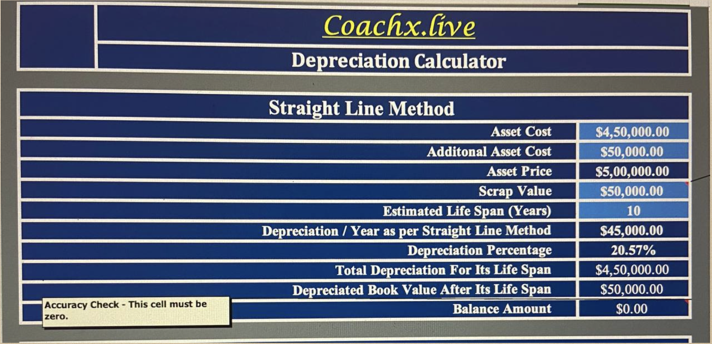

# Comparative Analysis of Depreciation Methods: Straight-Line vs. Diminishing Balance (WDV)

## 📊 Executive Summary
This project compares **Straight-Line Method (SLM)** and **Diminishing Balance / Written Down Value (WDV)** depreciation over a **10-year lifespan** for a **$5,00,000** asset ($4,50,000 initial cost + $50,000 additional cost) with a **$50,000** scrap value. It evaluates annual expense schedules, net book value trajectories, tax shield timing, and profit stability to guide capital accounting decisions.

---

## 🖥️ Dashboard & Financial Model Showcase

### 1. Straight-Line Method (SLM) Calculator

### 2. Diminishing Balance (WDV) Schedule

### 3. Total Depreciation Comparison

### 4. Summary of Findings & Strategic Recommendations

---

## 💡 Key Business Insights
* **Uniform vs. Accelerated Expense:** SLM deducts a steady **$45,000/year** (10% of depreciable value), whereas Diminishing Balance applies a **20.57% annual rate**, front-loading **$1,02,835.88** in Year 1 and tapering down to **$12,078.32** in the final year.
* **Early-Year Tax Shield Advantage:** Higher initial depreciation under WDV lowers taxable income during the first three years, freeing up immediate cash flow for reinvestment.
* **Realistic Asset Valuation:** WDV reduces the carrying book value rapidly in early years (dropping from $5,00,000 to $2,50,593.62 by Year 3), closely reflecting real-world market wear and obsolescence.

## 🎯 Strategic Recommendations
* **Choose Straight-Line (SLM)** for assets with consistent, long-term utility (such as buildings, office furniture, and basic fixtures) or when steady, predictable profit margins are the priority.
* **Choose Diminishing Balance (WDV)** for technology, machinery, and vehicles that lose market value quickly or require higher maintenance in later years, helping balance total ownership costs over time.

## 🛠️ Tools Used
* **Financial Modeling & Visualization:** Microsoft Excel
